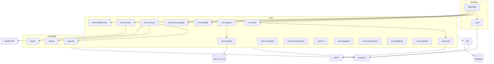
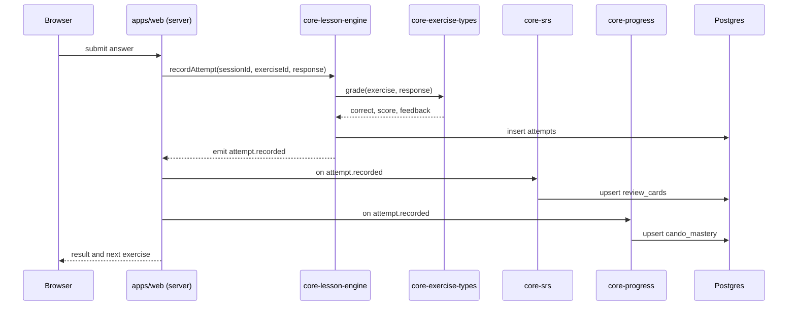

# 02. Architecture

## The box model

Stufen is a modular monolith. One deployable web app, one database, many boxes. A box is a package with a single job, a public interface, its own tests and its own changelog. Boxes never reach into each other. They share types and events through one package called `contracts`. The web app is the only place that composes boxes.

This is what makes a change small. Fixing a bug in review scheduling touches `core-srs` and nothing else. Adding a new exercise type touches `core-exercise-types` and nothing else. Adding Dutch adds `content/nl` and `lang-nl` and nothing else.

## Four kinds of box

| Kind | Prefix | Knows about | Never knows about |
|------|--------|-------------|-------------------|
| Infra | `db` | contracts, Postgres | any box, any language, any UI |
| Core | `core-` | contracts, `db`, its own tables | any language, any UI |
| Language | `lang-` | contracts, its content pack | UI, other languages, core internals |
| Surface | `apps/web`, `ui-kit` | contracts, every box's public API | box internals, database tables |

## Dependency rules

```
apps/web  ->  anything
core-*    ->  contracts, db
lang-*    ->  contracts
ui-kit    ->  contracts
db        ->  contracts
contracts ->  nothing
```

`db` is the only package that knows a database exists. It holds the Kysely instance, the pg driver, the migration runner and the table types. No box imports `pg` or `kysely` directly. See ADR-008.

Enforced by `scripts/check-boundaries.mjs`, which reads every `module.json` and fails if an import crosses a line. Run it before every commit. CI runs it on every push.

## Box map



One exception to "core never knows a language": `core-content` loads language packs through a registry. It knows the pack interface, not any pack's contents.

## What each box does

| Box | Job | Owns tables | Emits events |
|-----|-----|-------------|--------------|
| `contracts` | Types, event names, interfaces. No logic | none | none |
| `db` | Kysely instance on the pg driver, table types, migration runner. The only package that talks to Postgres | none | none |
| `core-auth` | Sign in with magic link and Google on better-auth. Sessions. Behind `AuthPort` (getSession, signInMagicLink, signInOAuth, signOut) | `users`, `sessions`, `accounts`, `verifications` | `user.signed_up` |
| `core-storage` | Files behind `StoragePort` (put, get, delete, signedUrl). Adapters: local filesystem, S3 compatible | none | none |
| `core-mail` | Email behind `MailPort` (send). Adapters: console, SMTP | none | none |
| `core-identity` | Profile, settings, target language | `profiles`, `learner_languages` | `user.language_set` |
| `core-curriculum` | The CEFR spine. Levels, can do descriptors, units, lessons as a graph | `cefr_levels`, `cando_descriptors`, `units`, `lessons` | none |
| `core-content` | Loads and validates content packs, installs them into the curriculum tables, tracks pack versions | `content_pack_versions`, `exercises`, `items` | `content.pack_installed` |
| `core-lesson-engine` | Runs a lesson session, orders exercises, records attempts | `lesson_sessions`, `attempts` | `attempt.recorded`, `lesson.completed` |
| `core-exercise-types` | Registry of exercise types. Each type has a renderer contract, a grader and a schema | none | none |
| `core-srs` | FSRS scheduling for items, review queue, review logging | `review_cards`, `review_logs` | `item.reviewed` |
| `core-progress` | Mastery per can do, level estimate, streaks | `cando_mastery`, `level_estimates`, `streaks` | `cando.mastered`, `level.reached` |
| `core-assessment` | Placement, checkpoints, exam simulation | `assessments` | `assessment.completed` |
| `core-ai-tutor` | Claude adapter: conversation, correction, writing rubric, explanations | `tutor_conversations`, `tutor_messages`, `writing_submissions` | `writing.graded`, `tutor.turn` |
| `core-speech` | Speech to text and text to speech behind one interface. Recordings stored through `core-storage` | `speech_recordings` | `speech.transcribed` |
| `core-feedback` | In app feedback capture | `feedback` | `feedback.submitted` |
| `core-analytics` | Event sink, subscribes to every event, writes `events` | `events` | none |
| `core-entitlements` | May this user do X. Plans, limits, feature flags. Payment adapter slot | `entitlements`, `feature_flags` | `entitlement.changed` |
| `lang-de` | German rules: article and case tables, verb conjugation helpers, tokenizer config, exam formats, TTS voice, immersion ramp | none | none |
| `ui-kit` | Design tokens and components | none | none |
| `apps/web` | Routes, pages, wiring, server actions | none | none |

Later boxes, already named so their slot exists: `core-notifications` (reminders), `core-admin` (content preview and review), `tools-content-forge` (generation pipeline, runs offline, not part of the app).

## Events

Boxes decouple through an in process typed event bus defined in `contracts`. A box emits. Any box may subscribe. Nobody calls another box's function to tell it something happened.

Example chain when a learner answers an exercise:

```
core-lesson-engine  emits  attempt.recorded {user, exercise, correct, score, cando_ids, item_ids}
core-srs            hears  attempt.recorded  and updates review_cards for item_ids
core-progress       hears  attempt.recorded  and updates cando_mastery, may emit cando.mastered
core-analytics      hears  everything        and writes an events row
```

Events are fire and forget inside one request. If a subscriber needs durability it writes its own table. There is no queue in beta. If one is needed later, the bus gets a Postgres backed adapter and no box changes.

## Request flow



## Runtime

| Layer | Choice | Why |
|-------|--------|-----|
| Web | Next.js (App Router), TypeScript, Tailwind | One codebase, server actions, runs anywhere Node runs |
| Data | PostgreSQL 16 or later through Kysely and pg in `packages/db`, row level security keyed on `app.user_id` | Open, portable, any host through `DATABASE_URL` |
| Auth | `core-auth` on better-auth, magic link plus Google, tables in our Postgres | No passwords to manage, no vendor account |
| Files | `core-storage`, local filesystem in dev and tests, S3 compatible in production | Works offline, any S3 endpoint in production |
| Email | `core-mail`, console in dev and tests, SMTP in production | Magic links without a vendor SDK |
| AI | Claude API via `@anthropic-ai/sdk`, server side only | Tutor, grading, content generation |
| SRS | `ts-fsrs` | Maintained FSRS implementation |
| Speech | Web Speech API now, adapter for a provider later | Zero cost to start |
| Tests | Vitest for boxes, Playwright for flows | Fast, standard |
| Monorepo | pnpm workspaces | Simple, no extra build tool needed |
| Hosting | Dockerfile builds the web app. Vercel works, so does any VPS | No provider specific code, see ADR-008 |
| Local | Docker Compose starts Postgres, `pnpm db:migrate` applies migrations | Whole app runs offline |

## Repository layout

```
packages/
  contracts/
  db/
    migrations/     numbered SQL, run by pnpm db:migrate
  core-auth/
  core-storage/
  core-mail/
  core-identity/
  core-curriculum/
  core-content/
  core-lesson-engine/
  core-exercise-types/
  core-srs/
  core-progress/
  core-assessment/
  core-ai-tutor/
  core-speech/
  core-feedback/
  core-analytics/
  core-entitlements/
  lang-de/
  ui-kit/
apps/
  web/
content/
  schema/
  de/
scripts/
docs/
docker-compose.yml    Postgres for local development and tests
Dockerfile            builds the web app for any container host
```

Every box has this shape:

```
packages/<box>/
  module.json      name, version, status, owner, depends_on, provides
  README.md        purpose, public API, how to change, how to test
  CHANGELOG.md
  src/index.ts     the only public surface
  src/...
  tests/
```

## Ports and adapters

Every box that persists data defines a small storage port: an interface listing only the reads and writes that box needs, nothing more. The box ships two adapters for it. An in memory adapter is used by unit tests, so they never touch a network or an account. A Postgres adapter, written on `db`, is used by the app and by integration tests against the Docker Postgres. The box logic talks only to the port, so swapping the adapter changes nothing in the box.

The same shape covers the outside world. `core-auth` sits behind `AuthPort`, `core-storage` behind `StoragePort`, `core-mail` behind `MailPort`. Each has a local adapter for dev and tests and a production adapter chosen by an environment variable. A provider is a deployment choice, never an import.

Authorisation is the box's own job. Every public function that touches learner data takes the signed in user id from `core-auth` and checks it. Row level security in Postgres is a second line, keyed on `app.user_id`, which `db` sets with `set_config` at the start of each request. See `docs/03-data-schema.md`.

## How a change happens

1. Find the box in `docs/07-build-sequence.md`.
2. Read its README. Note the public API.
3. Change the box. Keep the public API unless the change is the API. If the API changes, bump the box minor version and update every caller in `apps/web` in a separate commit.
4. Run the box tests and `check-boundaries`.
5. Update the box CHANGELOG and the build sequence row.
6. Commit with `type(box): message`.

## What stays common across languages

Everything under `core-`, `ui-kit`, `contracts` and `apps/web`. A language adds only a content pack and a `lang-` box. The `lang-` box is small: rules the grader needs (for example German noun gender and case endings for cloze feedback), exam formats, voice configuration, and the immersion ramp settings.
