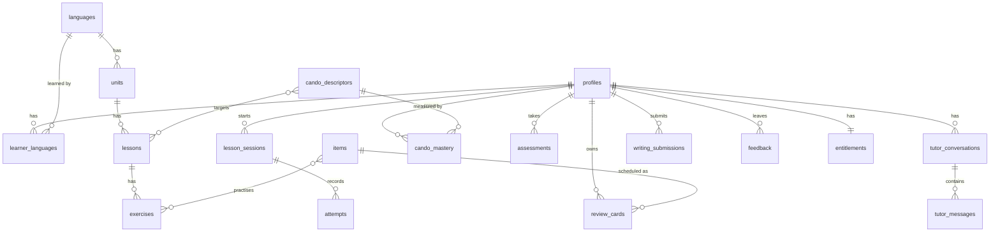

# 03. Data schema

Postgres on Supabase. Every table has row level security. Learners see only their own rows. Content tables are readable by any signed in user. Writes to content tables happen only through the service role during pack installation.

The SQL lives in `supabase/migrations/0001_init.sql`. This document explains it. Tables are grouped by the box that owns them. A box only reads and writes its own tables. When a box needs data from another box it uses that box's public API, not its tables.

## Conventions

- Primary keys are `uuid` with `gen_random_uuid()`, except reference tables keyed by a natural code.
- Every table has `created_at timestamptz default now()`. Mutable tables also have `updated_at`.
- Language is a two letter code from `languages.code` (`de`, `nl`, `fr`).
- CEFR level is one of `A1 A2 B1 B2 C1 C2`, stored as text with a check constraint.
- Skills use one enum: `reading, listening, spoken_production, spoken_interaction, writing, mediation, grammar, vocabulary`.
- JSON payloads (`jsonb`) carry exercise content and AI feedback. Their shape is defined by the JSON schemas in `content/schema/` and by the types in `contracts`.

## Entity overview

## core-identity

**profiles** One row per auth user. `id` references `auth.users`. Holds `display_name`, `ui_locale` (interface language, default `en`), `timezone`, `daily_goal_minutes`.

**learner_languages** Which languages a user is learning. `user_id`, `language_code`, `target_level`, `current_level_estimate`, `started_at`. A user can learn several languages. The app has an "active language" stored in `profiles.active_language`.

## core-curriculum

**languages** `code`, `name_en`, `name_native`, `status` (`active`, `coming`, `hidden`), `pack_version` currently installed.

**cefr_levels** `level`, `ordinal` (1 to 6), `label_en`. Reference table, seeded.

**cando_descriptors** The spine. `id`, `language_code` (null means the descriptor is the common CEFR one), `level`, `skill`, `code` (stable key like `A1.LIS.03`), `text_en`, `text_native`, `source` (citation string), `mastery_rule` jsonb (overrides for the default rule).

**units** `id`, `language_code`, `level`, `ordinal`, `slug`, `title`, `description`, `pack_version`.

**lessons** `id`, `unit_id`, `ordinal`, `slug`, `title`, `kind` (`core`, `review`, `production`, `checkpoint`), `estimated_minutes`, `cando_ids` uuid array, `pack_version`.

## core-content

**content_pack_versions** `language_code`, `version`, `checksum`, `installed_at`, `status` (`installing`, `active`, `superseded`, `failed`). Lets us roll a pack back.

**items** The learnable things that get scheduled for review. `id`, `language_code`, `kind` (`vocab`, `chunk`, `grammar`, `phrase`), `key` (stable string like `de:vocab:haus`), `lemma`, `gloss_en`, `level`, `frequency_rank`, `payload` jsonb (gender, plural, forms, example sentences, audio path), `pack_version`.

**exercises** `id`, `lesson_id`, `ordinal`, `type` (from the exercise type registry), `skill`, `payload` jsonb, `cando_ids` uuid array, `item_ids` uuid array, `pack_version`.

## core-lesson-engine

**lesson_sessions** `id`, `user_id`, `lesson_id`, `started_at`, `completed_at`, `score` (0 to 1), `exercise_order` uuid array.

**attempts** `id`, `user_id`, `session_id` (nullable, reviews and tutor tasks have no lesson session), `exercise_id` (nullable), `item_id` (nullable), `exercise_type`, `correct` boolean, `score` numeric 0 to 1, `response` jsonb, `feedback` jsonb, `duration_ms`, `created_at`. This is the evidence table. Mastery and level estimates derive from it.

## core-srs

**review_cards** `user_id`, `item_id`, FSRS state: `stability`, `difficulty`, `due`, `last_review`, `reps`, `lapses`, `state` (`new`, `learning`, `review`, `relearning`). Primary key `(user_id, item_id)`.

**review_logs** `id`, `user_id`, `item_id`, `rating` (1 again, 2 hard, 3 good, 4 easy), `reviewed_at`, `elapsed_days`, `scheduled_days`, `state_before`.

## core-progress

**cando_mastery** `user_id`, `cando_id`, `evidence_count`, `correct_count`, `exercise_types_seen` text array, `best_production_score` numeric, `recent_accuracy` numeric, `mastered_at` nullable, `updated_at`. Primary key `(user_id, cando_id)`.

**level_estimates** `id`, `user_id`, `language_code`, `level`, `confidence` 0 to 1, `method` (`placement`, `checkpoint`, `mastery_ratio`, `manual`), `created_at`. Append only. The latest row is the current estimate.

**streaks** `user_id`, `language_code`, `current_days`, `longest_days`, `last_active_date`.

## core-assessment

**assessments** `id`, `user_id`, `language_code`, `kind` (`placement`, `checkpoint`, `exam_sim`), `level`, `status` (`in_progress`, `completed`, `abandoned`), `score` numeric, `section_scores` jsonb, `result` jsonb, `started_at`, `completed_at`.

## core-ai-tutor

**tutor_conversations** `id`, `user_id`, `language_code`, `mode` (`chat`, `roleplay`, `explain`), `level`, `scenario` text nullable, `created_at`, `last_message_at`.

**tutor_messages** `id`, `conversation_id`, `role` (`user`, `assistant`), `content` text, `corrections` jsonb (array of `{span, error_type, correction, note}`), `input_tokens`, `output_tokens`, `model`, `created_at`.

**writing_submissions** `id`, `user_id`, `language_code`, `task_id` nullable (references an exercise when it came from a lesson), `prompt` text, `text` text, `target_level`, `rubric_scores` jsonb (`{task, coherence, vocabulary, grammar, overall}` each 0 to 5), `feedback` jsonb, `estimated_level`, `model`, `flagged_by_user` boolean, `created_at`.

## core-speech

**speech_recordings** `id`, `user_id`, `exercise_id` nullable, `storage_path`, `transcript`, `target_text`, `similarity` numeric, `provider`, `created_at`.

## core-feedback

**feedback** `id`, `user_id` nullable (anonymous allowed), `kind` (`bug`, `idea`, `confusing`, `rating`, `other`), `page`, `message`, `rating` 1 to 5 nullable, `context` jsonb (browser, level, lesson id), `status` (`new`, `seen`, `planned`, `done`, `wontfix`), `created_at`.

## core-analytics

**events** `id`, `user_id` nullable, `name`, `props` jsonb, `created_at`. Written by the analytics subscriber for every domain event. Sampled if volume becomes a problem.

## core-entitlements

**entitlements** `user_id` primary key, `plan` (`free_beta`, `free`, `plus`, `pro`), `features` jsonb (overrides), `limits` jsonb (`{tutor_messages_per_day, writing_grades_per_day, speech_minutes_per_day}`), `source` (`default`, `manual`, `stripe`), `expires_at` nullable, `updated_at`.

**feature_flags** `key`, `enabled` boolean, `rules` jsonb (percent rollout, allow list, level gate), `updated_at`.

**daily_usage** (view, migration 0002) Counts per user per local day from `tutor_messages`, `writing_submissions` and `speech_recordings`. Read by `core-entitlements` so it never touches another box's tables directly. See `docs/12-entitlements-and-payments.md`.

## Row level security summary

| Table group | Select | Insert or update |
|-------------|--------|------------------|
| Content (`languages`, `cefr_levels`, `cando_descriptors`, `units`, `lessons`, `exercises`, `items`, `content_pack_versions`, `feature_flags`) | any authenticated user | service role only |
| Learner data (everything keyed by `user_id`) | own rows | own rows |
| `feedback` | own rows | anyone, including anonymous insert |
| `events` | none for users | own rows insert |
| `entitlements` | own row | service role only |

## Indexes worth having from day one

- `attempts (user_id, created_at desc)`
- `attempts using gin (item_id)` is not needed since it is a scalar. Instead `attempts (user_id, exercise_id)`.
- `review_cards (user_id, due)` for the review queue.
- `cando_mastery (user_id, mastered_at)`.
- `exercises (lesson_id, ordinal)`.
- `items (language_code, level, frequency_rank)`.
- `events (name, created_at)`.

## Migration rules

- Files are `NNNN_short_name.sql`, four digits, never renumbered, never edited once applied to any shared environment.
- Every migration is reversible in a comment block at the bottom, even if we never run it.
- Seed data for `cefr_levels` and `languages` lives in `0001_init.sql`. Content pack data is installed by `core-content`, not by migrations.
