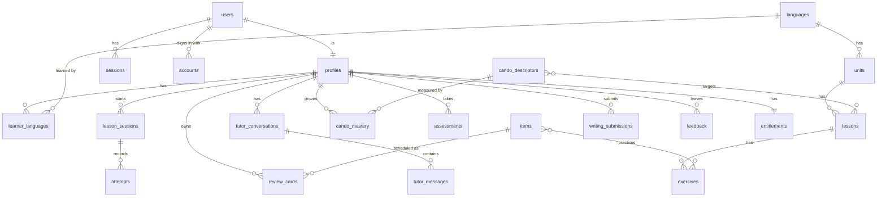

# 03. Data schema

PostgreSQL 16 or later, reached only through the `db` package (Kysely on the pg driver). Every table has row level security as a second line of defence. Learners see only their own rows. Content tables are readable by any signed in user. Writes to content tables happen only through the app's own database role during pack installation, with no `app.user_id` set.

The SQL lives in `packages/db/migrations/0001_init.sql` and the numbered files after it. This document explains it. Tables are grouped by the box that owns them. A box only reads and writes its own tables, through its own storage port and Postgres adapter. When a box needs data from another box it uses that box's public API, not its tables.

## Conventions

- Primary keys are `uuid` with `gen_random_uuid()` on most tables. Reference tables use a natural key (`languages.code`, `cefr_levels.level`, `feature_flags.key`). Tables that hold one row per user and thing use a composite key: `learner_languages`, `review_cards`, `cando_mastery`, `streaks`, `content_pack_versions`. `entitlements` is keyed by `user_id`.
- Timestamps are `timestamptz`. Most tables have `created_at`. Some name their creation time for what it is instead: `installed_at`, `started_at`, `reviewed_at`. `updated_at` exists, with a trigger that maintains it, on `users`, `profiles`, `review_cards`, `cando_mastery`, `entitlements`, `feature_flags` and the three auth tables from 0002. Other mutable tables do not track it yet; add the column in a migration when a box needs it.
- Language is a two letter code from `languages.code` (`de`, `nl`, `fr`).
- CEFR level is text. The check constraint lives on `cefr_levels.level`; every other level column is a foreign key to it.
- Skills use one enum: `reading, listening, spoken_production, spoken_interaction, writing, mediation, grammar, vocabulary`.
- JSON payloads (`jsonb`) carry exercise content and AI feedback. Their shape is defined by the JSON schemas in `content/schema/` and by the types in `contracts`.
- The typed copy of every table is `packages/db/src/schema.ts`. A test fails if a table in the migrations is missing there.

## Entity overview



## core-auth

These tables are shaped for better-auth and live in our Postgres like every other table. Fields are listed at summary level; the box README carries the exact columns.

**users** `id`, `email` unique, `email_verified` boolean, `name` nullable, `image` nullable, `created_at`, `updated_at`. The one table every `user_id` in the schema points at.

**sessions** `id`, `user_id`, `token` unique, `expires_at`, `ip_address` nullable, `user_agent` nullable, `created_at`, `updated_at`.

**accounts** One row per sign in method a user has linked. `id`, `user_id`, `provider_id` (`google`, `magic-link`), `account_id` (the id at the provider), `access_token`, `refresh_token`, `id_token`, `access_token_expires_at`, `scope`, all nullable, `created_at`, `updated_at`.

**verifications** Magic link and other short lived tokens. `id`, `identifier` (the email), `value` (the token), `expires_at`, `created_at`, `updated_at`.

`core-auth` reads and writes these through better-auth's Kysely adapter on `db`. No other box touches them. They are not learner data and have no `app.user_id` policy; access is limited to `core-auth` by the code, and RLS on them denies every role except the app's own.

## core-identity

**profiles** One row per user. `id` references `users(id) on delete cascade`. Holds `display_name`, `ui_locale` (interface language, default `en`), `timezone`, `daily_goal_minutes`.

**learner_languages** Which languages a user is learning. `user_id`, `language_code`, `target_level`, `current_level_estimate`, `started_at`. A user can learn several languages. The app has an "active language" stored in `profiles.active_language`.

## core-curriculum

**languages** `code`, `name_en`, `name_native`, `status` (`active`, `coming`, `hidden`), `pack_version` currently installed.

**cefr_levels** `level`, `ordinal` (1 to 6), `label_en`. Reference table, seeded.

**cando_descriptors** The spine. `id`, `language_code` (null means the descriptor is the common CEFR one), `level`, `skill`, `code` (stable key like `A1.LIS.03`), `text_en`, `text_native`, `source` (citation string), `mastery_rule` jsonb (overrides for the default rule).

**units** `id`, `language_code`, `level`, `ordinal`, `slug`, `title`, `description`, `pack_version`.

**lessons** `id`, `unit_id`, `ordinal`, `slug`, `title`, `kind` (`core`, `review`, `production`, `checkpoint`), `estimated_minutes`, `cando_ids` uuid array, `pack_version`.

## core-content

**content_pack_versions** `language_code`, `version`, `checksum`, `installed_at`, `status` (`installing`, `active`, `superseded`, `failed`). Lets us roll a pack back.

**items** The learnable things that get scheduled for review. `id`, `language_code`, `kind` (`vocab`, `chunk`, `grammar`, `phrase`), `key` (stable string like `de:vocab:haus`), `lemma`, `gloss_en`, `level`, `frequency_rank`, `payload` jsonb (gender, plural, forms, example sentences, audio path), `pack_version`.

**exercises** `id`, `lesson_id`, `ordinal`, `type` (from the exercise type registry), `skill`, `payload` jsonb, `cando_ids` uuid array, `item_ids` uuid array, `pack_version`.

## core-lesson-engine

**lesson_sessions** `id`, `user_id`, `lesson_id`, `started_at`, `completed_at`, `score` (0 to 1), `exercise_order` uuid array.

**attempts** `id`, `user_id`, `session_id` (nullable, reviews and tutor tasks have no lesson session), `exercise_id` (nullable), `item_id` (nullable), `exercise_type`, `correct` boolean, `score` numeric 0 to 1, `response` jsonb, `feedback` jsonb, `duration_ms`, `created_at`. This is the evidence table. Mastery and level estimates derive from it.

## core-srs

**review_cards** `user_id`, `item_id`, FSRS state: `stability`, `difficulty`, `due`, `last_review`, `reps`, `lapses`, `state` (`new`, `learning`, `review`, `relearning`). Primary key `(user_id, item_id)`.

**review_logs** `id`, `user_id`, `item_id`, `rating` (1 again, 2 hard, 3 good, 4 easy), `reviewed_at`, `elapsed_days`, `scheduled_days`, `state_before`.

## core-progress

**cando_mastery** `user_id`, `cando_id`, `evidence_count`, `correct_count`, `exercise_types_seen` text array, `best_production_score` numeric, `recent_accuracy` numeric, `mastered_at` nullable, `updated_at`. Primary key `(user_id, cando_id)`.

**level_estimates** `id`, `user_id`, `language_code`, `level`, `confidence` 0 to 1, `method` (`placement`, `checkpoint`, `mastery_ratio`, `manual`), `created_at`. Append only. The latest row is the current estimate.

**streaks** `user_id`, `language_code`, `current_days`, `longest_days`, `last_active_date`.

## core-assessment

**assessments** `id`, `user_id`, `language_code`, `kind` (`placement`, `checkpoint`, `exam_sim`), `level`, `status` (`in_progress`, `completed`, `abandoned`), `score` numeric, `section_scores` jsonb, `result` jsonb, `started_at`, `completed_at`.

## core-ai-tutor

**tutor_conversations** `id`, `user_id`, `language_code`, `mode` (`chat`, `roleplay`, `explain`), `level`, `scenario` text nullable, `created_at`, `last_message_at`.

**tutor_messages** `id`, `conversation_id`, `role` (`user`, `assistant`), `content` text, `corrections` jsonb (array of `{span, error_type, correction, note}`), `input_tokens`, `output_tokens`, `model`, `created_at`.

**writing_submissions** `id`, `user_id`, `language_code`, `task_id` nullable (references an exercise when it came from a lesson), `prompt` text, `text` text, `target_level`, `rubric_scores` jsonb (`{task, coherence, vocabulary, grammar, overall}` each 0 to 5), `feedback` jsonb, `estimated_level`, `model`, `flagged_by_user` boolean, `created_at`.

## core-speech

**speech_recordings** `id`, `user_id`, `exercise_id` nullable, `storage_path`, `transcript`, `target_text`, `similarity` numeric, `provider`, `created_at`.

## core-feedback

**feedback** `id`, `user_id` nullable (anonymous allowed), `kind` (`bug`, `idea`, `confusing`, `rating`, `other`), `page`, `message`, `rating` 1 to 5 nullable, `context` jsonb (browser, level, lesson id), `status` (`new`, `seen`, `planned`, `done`, `wontfix`), `created_at`.

## core-analytics

**events** `id`, `user_id` nullable, `name`, `props` jsonb, `created_at`. Written by the analytics subscriber for every domain event. Sampled if volume becomes a problem.

## core-entitlements

**entitlements** `user_id` primary key, `plan` (`free_beta`, `free`, `plus`, `pro`), `features` jsonb (overrides), `limits` jsonb (`{tutor_messages_per_day, writing_grades_per_day, speech_minutes_per_day}`), `source` (`default`, `manual`, `stripe`), `expires_at` nullable, `updated_at`.

**feature_flags** `key`, `enabled` boolean, `rules` jsonb (percent rollout, allow list, level gate), `updated_at`.

**daily_usage** (view, migration 0004) One row per user and local day: `user_id`, `day` as `YYYY-MM-DD` in the zone from `profiles.timezone`, `tutor_messages`, `writing_grades`, `speech_minutes`. Built from `tutor_messages` sent by the learner, `writing_submissions` and `speech_recordings.duration_ms`. It is a `security_invoker` view, so the row security of those tables applies and a learner sees only the own usage. Read by `core-entitlements`. See `docs/12-entitlements-and-payments.md`.

## Row level security summary

Authorisation is done by the boxes. Every public function that reads or writes learner data takes the signed in user id from `core-auth` and checks it before any query runs. Row level security is defence in depth, a second check inside Postgres in case a box gets it wrong.

**Two kinds of access.** The app connects with one login role that owns the tables and is a member of the role `stufen_app`. There is no service key.

- Learner facing work runs inside `withUser(db, userId, fn)`. It opens a transaction, runs `select set_config('app.user_id', $1, true)` with the user id or an empty string when nobody is signed in, and switches to `set local role stufen_app`. Inside `fn` only the grants and policies of `stufen_app` apply. Both settings are local to the transaction, so nothing leaks between requests on a pooled connection.
- Owner work uses the connection directly: sign up and sessions in `core-auth`, content pack installation, entitlement changes, account deletion, migrations. The owner is not subject to row level security.

Policies read the user id with a guard, because Postgres returns an empty string, not null, once a transaction local setting ends:

```sql
create policy attempts_own_select on attempts for select to stufen_app
  using (user_id = nullif(current_setting('app.user_id', true), '')::uuid);
```

Learner tables have three policies each, for select, insert and update. There is deliberately no delete policy: learner data is deleted by the owner connection during account deletion, where removing the `users` row cascades. No provider function appears in any policy.

| Table group | What `stufen_app` may do |
|-------------|--------------------------|
| Content (`languages`, `cefr_levels`, `cando_descriptors`, `units`, `lessons`, `exercises`, `items`, `content_pack_versions`, `feature_flags`) | Read everything, signed in or not. No writes; pack installation is owner work |
| `users` | Read the own row only. No writes; `core-auth` writes as owner (migration 0003) |
| `sessions`, `accounts`, `verifications` | Nothing. No grant and no policy (migration 0002) |
| Learner data (everything keyed by `user_id`) | Read, insert and update rows where `user_id` equals `app.user_id`. No delete |
| `tutor_messages` | All operations on messages of the own conversations |
| `feedback` | Insert for anyone including signed out; read own rows |
| `events` | Insert a row with a null user id or the own user id; never read (migration 0003) |
| `entitlements` | Read the own row. Writes go through `ensure_profile` or owner work |
| `schema_migrations` | Nothing (migration 0003) |

Every later migration grants `stufen_app` exactly what its new tables need. Nothing is granted by default.

## Indexes worth having from day one

- `attempts (user_id, created_at desc)`
- `attempts using gin (item_id)` is not needed since it is a scalar. Instead `attempts (user_id, exercise_id)`.
- `review_cards (user_id, due)` for the review queue.
- `cando_mastery (user_id, mastered_at)`.
- `exercises (lesson_id, ordinal)`.
- `items (language_code, level, frequency_rank)`.
- `events (name, created_at)`.

## Migration rules

- Files live in `packages/db/migrations/` as `NNNN_short_name.sql`, four digits, never renumbered, never edited once applied to any shared environment. A defect in an applied migration is fixed by a new one.
- The runner (`pnpm db:migrate`) applies missing files in order, each in a transaction, and records them in `schema_migrations`.
- Every migration names its owner box at the top and carries a rollback block as a comment at the bottom.
- Seed data for `cefr_levels` and `languages` lives in `0001_init.sql`. Content pack data is installed by `core-content`, not by migrations.

| File | Owner | What |
|------|-------|------|
| `0001_init.sql` | all core boxes | First schema, role `stufen_app`, row level security |
| `0002_auth.sql` | core-auth | `sessions`, `accounts`, `verifications`, owner only |
| `0003_policy_fixes.sql` | db | `users` readable as own row only and not writable by the app role, `schema_migrations` closed, anonymous `events` inserts, `feature_flags` trigger, explicit grants from now on |
| `0004_daily_usage.sql` | core-entitlements | `speech_recordings.duration_ms` and the view `daily_usage` |

