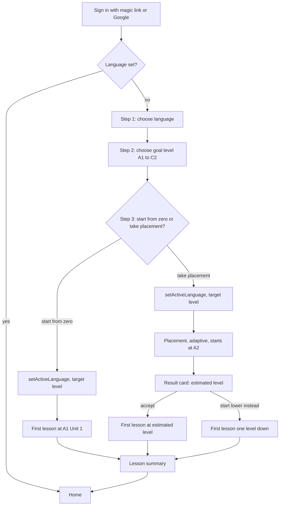

# 06. UI and UX

Version 0.1. Owner: Manisha Sarkar. Status: draft for Phase 0 to 5.

This document describes every screen in `apps/web`, the components in `ui-kit`, the exercise renderers, the design tokens and the copy rules. Boxes named here are the ones in `docs/02-architecture.md`. Routes and the boxes each route uses come from `docs/04-module-contracts.md`. Nothing in this document adds a box or a public API.

## 1. Design principles

| Principle | What it means in practice |
|-----------|---------------------------|
| One primary action per screen | Every screen has exactly one filled Button. Everything else is secondary or a link. On the home screen the primary action is the next lesson, or reviews if reviews are due |
| Immersion ramp | Interface language follows the learner's level using `immersionRamp` from the language pack. A1 is English. A2 is English with a German toggle. B1 is German with English on hover. B2 and above is German. The learner can override this in settings |
| Keyboard first on desktop | Every exercise can be completed without a mouse. Number keys pick choices, Enter submits and continues, Space plays audio, R toggles recording. A `?` overlay lists shortcuts |
| Mobile responsive PWA | One layout that reflows. Desktop gets a left rail. Mobile gets a bottom tab bar. Installable with a manifest and a service worker for the shell only, no offline content in beta |
| Accessibility WCAG AA | Contrast 4.5 to 1 for text, 3 to 1 for large text and controls. Visible focus rings. Every audio element has a transcript path. Every icon has a label. Reduced motion respected |
| Calm, not gamified | No confetti, no coins, no leaderboards, no red badges. Progress is shown as evidence. Streaks exist in `core-progress` and are shown as one quiet number, never as a threat |
| Evidence over streaks | The level map is the centrepiece. Every can do shows attempts, exercise types and best production score. The learner can always see why something is or is not mastered |
| Honest estimates | The app says "estimated level" everywhere. It never says "certified" or "you are B2" |

## 2. Information architecture

Navigation on desktop is a left rail with six entries: Home, Review, Tutor, Write, Progress, Settings. On mobile a bottom bar carries Home, Review, Tutor, Progress, and a More button that opens a Sheet with Write, Settings and Feedback. Lesson and assessment screens hide navigation and show only an exit control, so the learner is not pulled away mid task.

| Route | Purpose | Boxes used |
|-------|---------|------------|
| `/` | Daily loop: reviews due, next lesson, tutor, what moved | core-identity, core-progress, core-srs, core-curriculum |
| `/onboarding` | Choose language, goal level, start from zero or take placement | core-identity, core-assessment, core-entitlements |
| `/lesson/[id]` | Run one lesson session, 8 to 14 exercises, one production task at the end | core-lesson-engine, core-exercise-types, core-speech, core-ai-tutor (via graders) |
| `/review` | Spaced repetition queue, one card at a time | core-srs, core-exercise-types |
| `/tutor` | Text or voice conversation with corrections after each turn | core-ai-tutor, core-speech, core-entitlements |
| `/write` | Writing studio: longer text graded on the CEFR rubric | core-ai-tutor, core-entitlements |
| `/progress` | Level map A1 to C2 with evidence per can do and checkpoint entry | core-progress, core-curriculum |
| `/assess/[kind]` | Placement, checkpoint or exam simulation, `kind` is `placement`, `checkpoint` or `exam` | core-assessment |
| `/settings` | Profile, target language and level, interface language, audio, data | core-identity |
| `/feedback` | List of my feedback and the full feedback form | core-feedback |

The FeedbackFab appears on every route and talks to core-feedback. It is not a route.

Query parameters used by `/assess/[kind]`: `level` for checkpoint and exam, `format` for exam (an `ExamFormatId` from `lang-de`).

## 3. Screen by screen

Common layout rules apply to every screen. Content column maximum width is 720 px for reading and exercises, 960 px for the level map. Page padding is `--st-space-4` on mobile and `--st-space-6` on desktop. The FeedbackFab sits bottom right, above the mobile tab bar. Toasts stack bottom centre on mobile and top right on desktop.

Every screen handles four states the same way:

| State | Rule |
|-------|------|
| Loading | Skeleton blocks in the shape of the final layout. No spinners for page loads. Spinners only inside a Button that is waiting on a server action |
| Empty | One Card with a plain sentence and one Button that leads somewhere useful |
| Error | One Card with what happened, one retry Button, one link to feedback. Never a raw error string |
| Done | The screen shows the result and one Button to the next sensible place |

### 3.1 Home `/`

Purpose. The daily loop in one glance. Reviews due, the next lesson, the tutor, and what moved on the level map since last visit.

Layout. A greeting line with the LevelBadge for the estimated level. Below it three Cards in a column on mobile and a row on desktop: Reviews, Next lesson, Tutor. Below that a compact strip showing the last two changes on the level map (for example "A1.GRA.04 mastered"). The primary Button is on the Reviews card if reviews are due, otherwise on the Next lesson card.

```
+------------------------------------------------------------------+
| Stufen                                   [A1 est.]  Guten Morgen  |
+------------------------------------------------------------------+
| +------------------+ +------------------+ +--------------------+ |
| | Reviews          | | Next lesson      | | Tutor              | |
| | 14 due           | | Unit 2, Lesson 3 | | Talk about your    | |
| | ~6 min           | | Im Cafe          | | morning            | |
| | [ Start reviews ]| | ( Open lesson )  | | ( Open tutor )     | |
| +------------------+ +------------------+ +--------------------+ |
|                                                                  |
| Moved recently                                                   |
|  A1.GRA.04  Uses accusative articles   mastered   today          |
|  A1.SPI.02  Asks simple questions      5 of 6     yesterday      |
|                                                                  |
| Streak 4 days                                          [Feedback]|
+------------------------------------------------------------------+
```

Components. LevelBadge, Card, Button, Progress (inside the Next lesson card for unit progress), FeedbackFab, Toast.

States.

| State | Shown |
|-------|-------|
| Loading | Three skeleton cards |
| Empty (no language set) | Redirect to `/onboarding` |
| Empty (no reviews due) | Reviews card says "Nothing due. Next review at 18:00" and the primary Button moves to the lesson card |
| Empty (level finished, no next lesson) | Lesson card offers the checkpoint for the current level with a Button to `/assess/checkpoint?level=A1` |
| Error | Card with retry. Other cards still render if their data loaded |

Key interactions. Enter or the primary Button opens the highlighted card. `g r`, `g l`, `g t` jump to reviews, lesson, tutor. The "Moved recently" rows link to `/progress` with the can do expanded.

Data. `core-srs.stats` for due count, `core-curriculum.nextLessonFor` for the lesson, `core-progress.levelEstimate` and `core-progress.streak` for the header, `core-progress.masteryFor` for the moved rows.

### 3.2 Onboarding `/onboarding`

Purpose. Get from sign in to the first lesson or placement in under three minutes. See section 6 for the flow.

Layout. A single centred Card, one question per step, a step indicator at the top (1 of 4). Choices are large Choice components. One primary Button per step. Back is a text link.

```
+------------------------------------------------------------------+
|                          Step 2 of 4                             |
|                                                                  |
|            What level do you want to reach?                      |
|                                                                  |
|   ( ) A1   ( ) A2   ( ) B1   (o) B2   ( ) C1   ( ) C2            |
|                                                                  |
|   B2: understand complex texts, argue a view, take the           |
|   Goethe or telc B2 exam.                                        |
|                                                                  |
|   Back                                            [ Continue ]   |
+------------------------------------------------------------------+
```

Steps.

| Step | Question | Component | Writes |
|------|----------|-----------|--------|
| 1 | Which language? | Choice list, only German enabled in beta, Dutch and French shown as "coming later" | nothing yet |
| 2 | What level do you want to reach? | Choice row A1 to C2 with a one line description below the selected level | nothing yet |
| 3 | Start from zero or take placement? | Two large Choice cards | `core-identity.setActiveLanguage(userId, 'de', targetLevel)` |
| 4a | Placement | Redirect to `/assess/placement` | handled there |
| 4b | First lesson | Redirect to `/lesson/[id]` from `nextLessonFor` | handled there |

Components. Card, Choice, Button, LevelBadge (next to each level option), Toast.

States. Loading shows the card skeleton. Error on `setActiveLanguage` keeps the learner on step 3 with a retry. There is no empty state.

Key interactions. Arrow keys move between choices, Enter continues. The learner can return to onboarding from settings to add a language later. `core-entitlements.can(userId, 'levels_above_b1')` is checked on step 2; in beta it is always true, but the UI reads it so the gate exists.

### 3.3 Lesson `/lesson/[id]`

Purpose. Run one lesson session. Show one exercise at a time, grade it, show feedback, move on. End with the production task and a summary.

Layout. Navigation is hidden. The top bar has an exit control on the left, a Progress bar in the middle showing exercise n of N, and the immersion toggle on the right at A2. The exercise renderer fills the content column. The bottom area holds the primary Button ("Check" then "Continue") and a secondary "Skip" link. Feedback appears between the exercise and the button, never in a modal.

```
+------------------------------------------------------------------+
| x                    [=======>          ] 5 of 12                 |
+------------------------------------------------------------------+
|                                                                  |
|  Fill the gap.                                                   |
|                                                                  |
|  Ich trinke ____ Kaffee.                                         |
|                                                                  |
|  [ einen        ]                                                |
|                                                                  |
|  +------------------------------------------------------------+  |
|  | Correct. "Kaffee" is masculine, so the accusative is einen. |  |
|  +------------------------------------------------------------+  |
|                                                                  |
|  Skip                                            [ Continue ]    |
+------------------------------------------------------------------+
```

Components. Progress, Button, Choice, TextInput, AudioButton, RecordButton, CorrectionInline, RubricBars (on the production task), Card (for the summary), Sheet (exit confirmation and hint), Toast.

States.

| State | Shown |
|-------|-------|
| Loading | Top bar renders, content column shows a skeleton the size of a typical exercise |
| In progress | Exercise renderer for the current type. Button says Check |
| Graded | Feedback panel, Button says Continue, exercise inputs are read only |
| Waiting on AI | For `translate`, `write_free`, `speak_prompt`. The Check Button shows a spinner and the text "Grading". Inputs lock. If grading takes longer than 8 seconds a line appears: "Still grading. You can wait or skip" |
| Error | Feedback panel says the answer could not be graded, offers Retry and Skip. The attempt is not recorded until it grades |
| Done | Summary Card: score, items introduced, can dos touched with their new evidence counts, one Button "Back to home", one link "Review these words now" |

Key interactions. Enter checks, Enter again continues. Escape opens the exit Sheet ("Leave this lesson? Your progress so far is saved"). `H` opens a hint Sheet that calls `core-ai-tutor.explain` for the current grammar point (counts against the `tutor` limit). Skip records nothing and moves on; a skipped exercise is not evidence. On the last exercise the Button says Finish and calls `completeSession`.

Data. `startSession` on mount, `currentExercise` per step, `submitAnswer` on Check, `completeSession` at the end. Speech exercises call `core-speech.transcribe` and `saveRecording`.

### 3.4 Review `/review`

Purpose. Work through the due queue from `core-srs`. One card at a time, sentence context wherever the item has one.

Layout. Same focused layout as the lesson: exit on the left, a count "14 left" on the right. The item shows as the exercise type chosen for it (flashcard by default, cloze or dictation when the item has a sentence). After the answer is revealed, four rating buttons appear: Again, Hard, Good, Easy, mapped to ratings 1 to 4.

```
+------------------------------------------------------------------+
| x                                                      14 left   |
+------------------------------------------------------------------+
|                                                                  |
|                  Ich habe keine Zeit.                            |
|                                                                  |
|                  ( Show answer )                                 |
|                                                                  |
|  . . . . . . . . . . after reveal . . . . . . . . . . . . . . .  |
|                                                                  |
|                  I have no time.                                 |
|                  keine: negation of ein, feminine                |
|                                                                  |
|   [ Again 1 ]   [ Hard 2 ]   [ Good 3 ]   [ Easy 4 ]             |
+------------------------------------------------------------------+
```

Components. Button, Choice, TextInput, AudioButton, CorrectionInline, Card, Progress (thin, top), Toast.

States.

| State | Shown |
|-------|-------|
| Loading | Skeleton card |
| Empty | Card: "Nothing due right now. Next review at 18:00." Button "Go to next lesson" |
| In progress | Current card |
| Error | Card with retry; the queue position is kept |
| Done | Card: "14 reviewed. 3 again, 9 good, 2 easy." Button "Back to home" |

Key interactions. Space or Enter reveals. Keys 1 to 4 rate. Space plays audio when the item has it. Escape exits with no confirmation because every rating is already saved. Each rating calls `core-srs.review`. When the item is shown as a graded exercise (cloze, dictation) the grade also goes to `core-lesson-engine.recordStandaloneAttempt` so the can do gets evidence.

### 3.5 Tutor `/tutor`

Purpose. Conversation at the learner's level, typed or spoken, with corrections after each learner turn.

Layout. Desktop is two columns: the conversation on the left (two thirds), a side panel on the right with scenario, level, mode and the running list of corrections for this conversation. Mobile is the conversation full width with the side panel behind a Sheet. The composer at the bottom has a TextInput, a RecordButton and a send Button. Corrections appear as CorrectionInline under the learner's own message, marked by category.

```
+------------------------------------------------------------------+
| Tutor                                 Scenario: Im Cafe   [A1]   |
+---------------------------------------------+--------------------+
| Tutor: Guten Tag! Was moechten Sie trinken? | Corrections (2)    |
|                                             |                    |
| You: Ich moechte ein Kaffee, bitte.         | ein > einen        |
|   ein > einen   (case)                      |   case             |
|                                             | Kaffee OK          |
| Tutor: Gern. Einen Kaffee. Mit Milch?       |                    |
|                                             | Mode: text         |
|                                             | Level: A1          |
|                                             | End conversation   |
+---------------------------------------------+--------------------+
| [ Type your reply                    ]  (mic)  [ Send ]          |
+------------------------------------------------------------------+
```

Components. Card, Button, TextInput, RecordButton, AudioButton (on tutor messages, plays TTS through core-speech), CorrectionInline, LevelBadge, Sheet, Toast.

States.

| State | Shown |
|-------|-------|
| Loading | Conversation column skeleton |
| Empty (no conversation yet) | Card with three scenario Choices at the learner's level plus "Free talk". Primary Button "Start" |
| Streaming | Tutor message grows word by word. Composer is disabled until the final chunk arrives |
| Limit reached | Card: "You have used today's tutor turns. They reset at midnight." Link to settings. From `core-entitlements.remaining` |
| Error | Toast "That reply did not send. Try again." The learner's text stays in the composer |
| Done | "End conversation" shows a Card with the correction list grouped by category and a Button "Back to home" |

Key interactions. Enter sends, Shift plus Enter adds a line. R toggles recording; releasing shows the transcript in the composer for editing before send. Clicking a correction opens a Sheet with the explanation from the final chunk, and a Button "Explain more" that calls `explain`. `sendTurn` streams `TutorChunk` items; the final chunk carries the corrections. English explanations are available on request at A1 and A2 per the immersion ramp.

### 3.6 Writing studio `/write`

Purpose. Longer texts, graded on the CEFR rubric with line by line feedback.

Layout. Desktop two columns: the editor on the left, the result on the right after grading. Mobile stacks them. The top of the editor shows the task prompt (from a lesson task, or chosen from a list of prompts at the learner's level, or free). A word count and a target range sit under the editor. The primary Button is "Grade my text".

```
+------------------------------------------------------------------+
| Writing studio                                    Target: B1     |
+-------------------------------+----------------------------------+
| Task: Write an email to a     | Estimated level  B1              |
| friend about your weekend.    |                                  |
| 80 to 120 words.              | Task        [====   ] 4 of 5     |
|                               | Coherence   [===    ] 3 of 5     |
| +---------------------------+ | Vocabulary  [===    ] 3 of 5     |
| | Am Wochenende bin ich ... | | Grammar     [==     ] 2 of 5     |
| |                           | |                                  |
| |                           | | Line 2: "mit meine Freunde"      |
| +---------------------------+ |   mit meinen Freunden (dative)   |
| 96 words                      | Line 4: "Ich habe gegangen"      |
|                               |   Ich bin gegangen (auxiliary)   |
| [ Grade my text ]             |                                  |
+-------------------------------+----------------------------------+
```

Components. Card, TextInput (multiline), Button, RubricBars, CorrectionInline, LevelBadge, Progress (word count against target), Sheet (prompt picker), Toast.

States.

| State | Shown |
|-------|-------|
| Loading | Editor renders immediately, prompt list skeleton in the Sheet |
| Empty | Editor with the prompt picker open |
| Grading | Button spinner with "Grading", editor locked, result column shows a skeleton of RubricBars |
| Graded | RubricBars, estimated level, corrections list. Button becomes "Revise and regrade". A link "Flag this grade" opens the FeedbackFab Sheet with kind preset to `other` and the submission id in context |
| Limit reached | Card from `core-entitlements.remaining(userId, 'writing_studio')` |
| Error | Toast plus the text is kept in the editor. Draft is also kept in local storage until graded |

Key interactions. Ctrl plus Enter grades. Clicking a correction scrolls the editor to that line and highlights it. `gradeWriting` returns the `WritingGrade`; the result is stored by core-ai-tutor and appears again under "Past texts" at the bottom of the screen.

### 3.7 Progress `/progress`

Purpose. The level map. See section 5.

Layout. Header with the estimated level, confidence and method (placement, checkpoint, mastery). Below, the LevelMap component: six level rows, the current level expanded. Each expanded level lists can dos grouped by skill with evidence.

Components. LevelMap, LevelBadge, Card, Progress, Button, Sheet (can do detail), Toast.

States.

| State | Shown |
|-------|-------|
| Loading | Six skeleton rows |
| Empty (brand new learner) | A1 expanded with all can dos at zero evidence, a line "Evidence appears as you complete exercises", Button "Start first lesson" |
| Error | Card with retry |
| Done | Not applicable, the map is always live |

Key interactions. Click or Enter on a level row expands it. Click on a can do opens a Sheet with its full evidence table and links to lessons that practise it. The checkpoint Button on a level starts `/assess/checkpoint?level=X`.

### 3.8 Assessment `/assess/[kind]`

Purpose. Placement, checkpoint or exam simulation. Same screen, different pacing and result.

Layout. Focused layout like the lesson. The top bar shows the kind, the section name for exams (Hoeren, Lesen, Schreiben, Sprechen), a Progress bar and a timer when the format has a time limit. Questions use the same exercise renderers. There is no feedback after each answer during an assessment; feedback comes at the end.

```
+------------------------------------------------------------------+
| x   Checkpoint A1            [======>      ] 8 of 20      12:40  |
+------------------------------------------------------------------+
|                                                                  |
|  Listen and choose.                                              |
|                                                                  |
|  (play)                                                          |
|                                                                  |
|  ( ) Er faehrt nach Berlin.                                      |
|  (o) Er faehrt nach Bremen.                                      |
|  ( ) Er bleibt zu Hause.                                         |
|                                                                  |
|                                                    [ Next ]      |
+------------------------------------------------------------------+
```

Components. Progress, Button, Choice, TextInput, AudioButton, RecordButton, Card (intro and result), LevelBadge, RubricBars (for writing and speaking sections in exams), Sheet (exit confirmation), Toast.

States.

| State | Shown |
|-------|-------|
| Intro | Card: what this is, how long, what it decides. Primary Button "Begin". For placement: "About 15 minutes. It starts at A2 and adapts" |
| In progress | Question. Answers lock on Next |
| Timer out | Section ends, moves to the next section or finishes |
| Grading | Card "Scoring your answers", production tasks wait on AI |
| Result, placement | Card: "Estimated level A2. We will start you at Unit 1 of A2." Secondary link "Start at A1 instead" |
| Result, checkpoint | Card: score, pass or not at 0.7, per skill breakdown, Button "Continue to B1" or "Back to lessons" |
| Result, exam | Card: per section scores in the format's own scale, overall pass estimate, Button "Back to progress" |
| Error | Card with retry. Answers already given are kept by `core-assessment` |

Key interactions. Same keys as exercises. Escape asks to confirm; leaving a placement discards it, leaving a checkpoint or exam keeps the answers so far and can be resumed from `/progress`. No Skip in assessments. `finish` calls `core-progress.recordEstimate` and may emit `level.reached`, which the result Card announces plainly.

### 3.9 Settings `/settings`

Purpose. Profile, languages, interface language, audio, and data.

Layout. A single column of Cards, one per group. Each Card saves on change with a Toast, no global save button, so the one primary action rule is met by having none.

```
+------------------------------------------------------------------+
| Settings                                                         |
+------------------------------------------------------------------+
| Profile                                                          |
|   Name       [ Manisha          ]                                |
|   Email      manisha@...   (from sign in)                        |
+------------------------------------------------------------------+
| Language                                                         |
|   Active     German   Target level [ B2 v ]                      |
|   + Add a language (Dutch and French coming later)               |
+------------------------------------------------------------------+
| Interface                                                        |
|   Language   (o) Follow my level  ( ) English  ( ) German        |
|   Theme      (o) System  ( ) Light  ( ) Dark                     |
|   Motion     [x] Reduce animation                                |
+------------------------------------------------------------------+
| Audio                                                            |
|   Autoplay audio in exercises   [x]                              |
|   Microphone                    Test microphone                  |
+------------------------------------------------------------------+
| Data                                                             |
|   Plan: free beta                                                |
|   Sign out          Delete my account                            |
+------------------------------------------------------------------+
```

Components. Card, TextInput, Choice, Button, LevelBadge, Sheet (delete confirmation), Toast.

States. Loading shows skeleton cards. Error shows a Toast and reverts the field. No empty or done state.

Key interactions. Changing target level calls `setActiveLanguage`. Interface language override is stored on the profile and read by the immersion helper in `apps/web`. Delete account opens a Sheet that requires typing the word "delete". Plan is read from `core-entitlements.plan` and is read only in beta.

### 3.10 Feedback `/feedback`

Purpose. See my past feedback and write longer feedback than the FeedbackFab Sheet allows.

Layout. Form Card at the top, list of past items below with kind, date and the first line.

Components. Card, Choice (kind), TextInput (multiline), Button, Toast.

States. Empty list: "You have not sent feedback yet." Loading: skeleton list. Error: Toast and text kept. Done: Toast "Sent. Thank you." and the item appears at the top of the list.

Key interactions. Ctrl plus Enter submits. Uses `core-feedback.submit` and `listMine`.

## 4. Exercise renderers

Every exercise type in `core-exercise-types` has a `rendererKey`. `apps/web` maps each key to one component under `apps/web/components/exercises/`. Renderers share one shell: instruction line, stimulus, input, feedback slot, action row. Renderers receive the exercise payload and return a response object; they never grade. Grading is `submitAnswer`.

Shared rules across all renderers:

| Rule | Detail |
|------|--------|
| Feedback placement | Below the input, inside the exercise column, never a modal or a toast |
| Feedback colour | Correct uses `--st-color-success` text on `--st-color-success-soft` background. Incorrect uses `--st-color-error` on `--st-color-error-soft`. Partial uses `--st-color-warning`. Colour is never the only signal: an icon and the words Correct, Not quite, or Partly correct always appear |
| Error categories | When `GradeResult.errorTypes` is present, each category shows as a small label: article, case, gender, word order, spelling, tense, register, vocabulary |
| Lenient compare | Text graders use `lang-de.normalize`, so "ss" for "ß" and missing umlaut dots are marked as spelling, not as wrong |
| Audio | Any exercise with audio shows an AudioButton. Space plays or pauses. A "Show transcript" link is always present for accessibility, but is hidden until after grading for listening exercises |
| Keyboard | Enter checks, Enter continues, Escape opens exit, `H` hint, `?` shortcut overlay |

### 4.1 multiple_choice

Input. A vertical Choice list, two to five options, single select. Stimulus may be text or audio.
Answer shown. The selected option is highlighted with the accent border.
Correction. The correct option gets the success border and a tick. A wrong selection keeps its border in the error colour. One line of feedback below.
Keys. 1 to 5 select, arrow keys move, Enter checks.

### 4.2 cloze

Input. Sentence with one or more gaps rendered inline. Each gap is a TextInput sized to the expected answer, or a Choice drop list when the payload gives options. Focus lands in the first gap.
Answer shown. The learner's text stays in the gap.
Correction. Each gap is marked separately. A wrong gap shows the expected form directly under it via CorrectionInline, with the error category from `classifyError`. Feedback line explains the rule in one sentence, in the immersion language.
Keys. Tab moves between gaps, Enter checks, 1 to 5 pick from a drop list.

### 4.3 match_pairs

Input. Two columns of Choice tiles, four to six pairs. Tap or click one left then one right. Matched pairs dim and lock. On desktop the left column tiles are numbered and the right column lettered.
Answer shown. Matched pairs are drawn with a joining line in the accent colour.
Correction. Every pair is checked on Check. Wrong pairs unmatch and show the correct partner in the success colour for two seconds, then the learner can continue. Score is the fraction of pairs right on first try.
Keys. Number then letter picks a pair, for example `2 c`. Backspace undoes the last pair.

### 4.4 order_words

Input. A word bank of Choice chips below an answer row. Click a chip to append it, click it in the answer row to return it. Drag is supported but never required.
Answer shown. The answer row reads as a sentence.
Correction. The correct sentence appears below the answer row with the first differing word underlined. Error category is usually word order.
Keys. Number keys append the nth chip, Backspace removes the last word, Enter checks.

### 4.5 translate

Input. Source sentence in the stimulus, a multiline TextInput for the target. Direction is in the payload, German to English or English to German.
Answer shown. The learner's sentence stays in the box, read only after grading.
Correction. AI graded through `aiGrade`. Feedback shows a reference translation, the learner's version with CorrectionInline marks, and a score out of 1 shown as a thin Progress. Several correct answers are accepted; the feedback says "Also correct" when the learner's version differs from the reference but passes.
Keys. Enter checks (Shift plus Enter for a new line).

### 4.6 dictation

Input. AudioButton plays a sentence. A multiline TextInput receives the transcription. Replay is unlimited but the count is recorded in the response.
Answer shown. The learner's text.
Correction. Word by word diff against the target using `core-speech.compare` for the diff shape. Missing words show in the error colour, extra words are struck through, spelling slips show as spelling. The transcript is revealed after grading.
Keys. Space plays or replays when the input is empty, otherwise Ctrl plus Space. Enter checks.

### 4.7 read_answer

Input. A short text in a Card, up to 200 words at A1 and longer at higher levels, followed by one to three questions. Each question is a Choice list or a short TextInput as the payload says.
Answer shown. Per question.
Correction. Per question, in place. For text answers the grader accepts lenient matches. A "Show where" link highlights the sentence in the text that answers the question.
Keys. Tab between questions, 1 to 5 select, Enter checks.

### 4.8 listen_answer

Input. AudioButton plays a text, then one to three questions as in read_answer. At A1 the audio may be played any number of times; from B1 the payload can limit plays to two, shown as "2 plays left".
Answer shown. Per question.
Correction. Per question. Transcript revealed after grading with the relevant sentence highlighted.
Keys. Space plays, Tab between questions, Enter checks.

### 4.9 write_free

Input. Prompt in a Card, a multiline TextInput with a word count and target range. This is the production task at the end of a lesson.
Answer shown. The text, read only after grading.
Correction. AI graded. RubricBars with the rubric criteria at this level (task, coherence, vocabulary, grammar) each out of 5, then CorrectionInline items line by line. The best score feeds `best_production_score` on the can do. A line under the bars says "Score 3 of 5 counts as evidence for writing" so the learner knows what the number does.
Keys. Ctrl plus Enter checks.

### 4.10 speak_prompt

Input. Prompt in a Card, sometimes with a model sentence and an AudioButton to hear it. RecordButton starts and stops recording. After stopping, the transcript from `core-speech.transcribe` appears in a TextInput the learner may correct once before submitting, because browser recognition is imperfect and the goal is to test speaking, not the recogniser.
Answer shown. The transcript and a small player for the recording.
Correction. Two parts. First `core-speech.compare` gives similarity and a word diff against the target when there is one. Then `aiGrade` scores the content as production out of 5, shown with RubricBars. If the microphone is denied, the renderer offers "Type your answer instead" and marks the response as typed so it counts as writing evidence, not speaking.
Keys. R starts and stops recording, Space plays the model, Enter submits.

### 4.11 flashcard

Input. Front of card shows the item, in sentence context when available. A single Button "Show answer" flips it. Used mainly by `/review`.
Answer shown. Back of card: translation, gender and plural for nouns, one example sentence, AudioButton.
Correction. There is no grading. The learner self rates with four Buttons mapped to 1 to 4 for `core-srs.review`. The card is not evidence for a can do on its own.
Keys. Space flips, 1 to 4 rate.

## 5. Level map

The level map is the answer to "what have I proven". It is the `LevelMap` component in `ui-kit`, fed by `core-progress.levelMap(userId, language)`.

### 5.1 Ladder

Six rows, C2 at the top, A1 at the bottom, so the learner reads upward. Each row shows the LevelBadge, the level name from the pack in the immersion language, mastered count over total, a thin Progress bar, and a state chip.

```
+------------------------------------------------------------------+
| Estimated level  A2   confidence high   from checkpoint 3 Sep    |
+------------------------------------------------------------------+
| C2  [locked]   0 of 48                                           |
| C1  [locked]   0 of 58                                           |
| B2  [locked]   0 of 60                                           |
| B1  [in progress]  12 of 61   [====>              ]              |
| A2  [mastered]     53 of 53   [===================]  Checkpoint 0.84
| A1  [mastered]     45 of 45   [===================]  Checkpoint 0.91
+------------------------------------------------------------------+
| B1 expanded                                                      |
|                                                                  |
| Reading                                                          |
|  B1.REA.01  Understands the main points of clear standard text   |
|             mastered   9 attempts   read_answer, cloze   90%     |
|  B1.REA.02  Finds specific information in everyday material      |
|             in progress   4 of 6 attempts   read_answer   75%    |
| Writing                                                          |
|  B1.WRI.01  Writes connected text on familiar topics             |
|             in progress   6 attempts   write_free   best 2 of 5  |
|             needs: best production score 3 of 5                  |
| Grammar                                                          |
|  B1.GRA.01  Uses the genitive with common prepositions           |
|             not started                                          |
|                                                                  |
|                                     ( Take B1 checkpoint )       |
+------------------------------------------------------------------+
```

### 5.2 Level states

| State | Rule | Visual |
|-------|------|--------|
| Mastered | 80 percent of can dos mastered and checkpoint score at least 0.7 | Success chip, checkpoint score shown |
| In progress | Any evidence at this level, or the level directly above the highest mastered level | Accent chip, Progress bar, checkpoint Button |
| Locked | No evidence and not the next level | Muted chip, row is still expandable so the learner can read what the level asks for |

Locked never hides content. A learner may open a locked level and read its can dos. Lessons at a locked level are reachable from the row but the app says "Most learners do A2 first" rather than refusing. `levels_above_b1` from `core-entitlements` is the only real gate and is true in beta.

### 5.3 Can do rows

Each can do row shows:

| Column | Source |
|--------|--------|
| Code and description | `core-curriculum.listCandos`, description in the immersion language, hover or tap shows the other language at A2 and B1 |
| State | mastered, in progress, not started, from `CandoMastery` |
| Attempts | `evidence_count`, shown as "9 attempts" or "4 of 6 attempts" while under the threshold |
| Exercise types seen | Distinct types with a correct attempt, shown as small labels. If only one type, the row says "needs a second exercise type" |
| Recent accuracy | Last 10 attempts as a percentage |
| Best production score | For writing, spoken production and spoken interaction only, "best 2 of 5" |
| Needs line | Whatever part of the mastery rule is unmet, in plain words. Empty when mastered |

Clicking a row opens a Sheet with the full attempt history (date, exercise type, correct, score) and links to the lessons that practise this can do.

### 5.4 Checkpoint button

The checkpoint Button appears on an in progress level once 80 percent of its can dos are mastered. Before that it shows as a disabled Button with the text "Checkpoint unlocks at 80 percent" and the current percentage. It leads to `/assess/checkpoint?level=X`. A completed checkpoint shows its score and date next to the level; a failed one shows "Checkpoint 0.62, retake available" with no waiting period, because the evidence rule is the real gate.

Exam simulation Buttons appear on mastered and in progress levels from B1 upward, one per format in `lang-de.examFormats`, gated by `exam_sim`.

## 6. Onboarding flow



The placement itself lives on `/assess/placement`. Onboarding is finished when `user.language_set` has been emitted, so a learner who abandons placement still lands on Home with A1 as the estimate and can retake placement from Progress.

## 7. Design tokens

Tokens live in `packages/ui-kit/src/tokens.ts` and are emitted as CSS variables on `:root` with a `[data-theme="dark"]` block. Tailwind reads them through `theme.extend`. No component uses a raw hex value.

### 7.1 Colour

One accent, a deep teal. Neutrals are warm greys so long reading sessions are easy on the eye. Every text pair listed here was checked at 4.5 to 1 or better.

| Token | Light | Dark | Use |
|-------|-------|------|-----|
| `--st-color-bg` | `#F7F6F3` | `#15181A` | Page background |
| `--st-color-surface` | `#FFFFFF` | `#1E2224` | Cards, sheets, inputs |
| `--st-color-surface-2` | `#EFEDE8` | `#272C2F` | Skeletons, chips, disabled |
| `--st-color-border` | `#D9D6CF` | `#3A4145` | Card and input borders |
| `--st-color-text` | `#1F2421` | `#ECEAE4` | Body text |
| `--st-color-text-muted` | `#5C625E` | `#A3A9A5` | Secondary text, labels |
| `--st-color-accent` | `#2F6F73` | `#6FB1B5` | Primary button, links, focus, selected |
| `--st-color-accent-hover` | `#255A5D` | `#8BC4C7` | Hover and active |
| `--st-color-accent-soft` | `#DCEBEB` | `#23393B` | Selected background, level in progress |
| `--st-color-on-accent` | `#FFFFFF` | `#15181A` | Text on accent |
| `--st-color-success` | `#2E7D4F` | `#6CC28E` | Correct, mastered |
| `--st-color-success-soft` | `#DFF0E5` | `#1F3328` | Correct feedback background |
| `--st-color-error` | `#B4432F` | `#E5806C` | Incorrect, destructive |
| `--st-color-error-soft` | `#F6E1DC` | `#3A231E` | Incorrect feedback background |
| `--st-color-warning` | `#8A5F10` | `#D9A94A` | Partial, limits |
| `--st-color-warning-soft` | `#F4EAD2` | `#33290F` | Partial feedback background |
| `--st-color-focus` | `#2F6F73` | `#6FB1B5` | Focus ring, 2 px solid plus 2 px offset |

Level colours are not a rainbow. All six LevelBadges use the accent; mastered uses success, locked uses text muted on surface 2. The level is told by the letters, not the colour.

### 7.2 Type

Font stack: `"Inter", "Segoe UI", system-ui, sans-serif`. Inter is loaded locally, not from a CDN. German text in exercises renders one step larger than UI text so the target language is always the biggest thing on screen.

| Token | Size / line height | Use |
|-------|--------------------|-----|
| `--st-text-xs` | 12 / 16 | Labels, error categories |
| `--st-text-sm` | 14 / 20 | Secondary text, table cells |
| `--st-text-base` | 16 / 24 | UI body |
| `--st-text-md` | 18 / 28 | Exercise stimulus, tutor messages |
| `--st-text-lg` | 20 / 28 | Section headings, cloze sentences |
| `--st-text-xl` | 24 / 32 | Screen titles |
| `--st-text-2xl` | 30 / 36 | Flashcard front, onboarding question |
| `--st-text-3xl` | 36 / 40 | Result numbers |

Weights: 400 regular, 500 medium for labels and buttons, 600 semibold for headings. No bold above 600. `--st-font-sans` and `--st-font-mono` (for codes like `A1.GRA.04`, stack `"JetBrains Mono", ui-monospace, monospace`).

### 7.3 Spacing

Base 4 px.

| Token | Value |
|-------|-------|
| `--st-space-0` | 0 |
| `--st-space-1` | 4 px |
| `--st-space-2` | 8 px |
| `--st-space-3` | 12 px |
| `--st-space-4` | 16 px |
| `--st-space-5` | 24 px |
| `--st-space-6` | 32 px |
| `--st-space-7` | 48 px |
| `--st-space-8` | 64 px |

Content widths: `--st-width-read` 720 px, `--st-width-wide` 960 px. Touch targets minimum 44 by 44 px, `--st-target-min`.

### 7.4 Radius

| Token | Value | Use |
|-------|-------|-----|
| `--st-radius-sm` | 4 px | Chips, labels, inline corrections |
| `--st-radius-md` | 8 px | Buttons, inputs, choices |
| `--st-radius-lg` | 12 px | Cards, sheets |
| `--st-radius-full` | 999 px | LevelBadge, FeedbackFab, RecordButton |

### 7.5 Shadow and border

Cards use a 1 px border and no shadow in light theme. Sheets and the FeedbackFab use `--st-shadow-md`: `0 4px 16px rgba(0,0,0,0.12)` light, `0 4px 16px rgba(0,0,0,0.5)` dark. Nothing else has a shadow.

### 7.6 Motion

| Token | Value | Use |
|-------|-------|-----|
| `--st-motion-fast` | 120 ms | Hover, focus, chip state |
| `--st-motion-base` | 200 ms | Feedback panel appearing, choice selection |
| `--st-motion-slow` | 300 ms | Sheet open and close, flashcard flip |
| `--st-ease` | `cubic-bezier(0.2, 0, 0, 1)` | All transitions |

Rules. Nothing bounces. Nothing loops except the recording pulse on RecordButton and the streaming caret in the tutor. Progress bars animate width once. When `prefers-reduced-motion: reduce` is set, or the setting "Reduce animation" is on, every duration becomes 0 and the flashcard flip becomes a cross fade of 0 ms. Level up on the map is a single colour change of the row, no fireworks.

### 7.7 Token export

`packages/ui-kit/src/tokens.ts` exports one object `tokens` with the groups `color.light`, `color.dark`, `text`, `space`, `radius`, `shadow`, `motion`, `width`, and one function `toCssVariables(theme)` returning the `:root` string. The variable names above are the contract. Adding a token is a minor version bump of `ui-kit`.

## 8. Feedback capture

Beta target from the PRD: a tester leaves feedback in under 30 seconds without leaving the screen.

FeedbackFab is a round Button, 48 px, bottom right, `--st-color-accent`, with a speech bubble icon and the label "Feedback" for screen readers. It is present on every route including lesson and assessment screens, where it sits at 60 percent opacity until hovered or focused so it does not compete with the exercise. Keyboard shortcut `f` opens it from anywhere outside a text input.

Opening it shows a Sheet from the bottom on mobile and from the right on desktop.

```
+---------------------------------------------+
| Feedback                                x   |
+---------------------------------------------+
| What is it?                                 |
| (o) Bug  ( ) Idea  ( ) Confusing            |
| ( ) Rating  ( ) Other                       |
|                                             |
| [ Tell us what happened                  ]  |
| [                                        ]  |
|                                             |
| How is Stufen so far?   1  2  3  4  5       |
|                                             |
| We attach the page, your level and the      |
| exercise id so we can find it.              |
|                                             |
|                              [ Send ]       |
+---------------------------------------------+
```

| Field | Detail |
|-------|--------|
| kind | Choice row: `bug`, `idea`, `confusing`, `rating`, `other`. Defaults to `confusing` on exercise screens, `idea` elsewhere. Callers can preset it, for example "Flag this grade" |
| message | Multiline TextInput, required except when kind is `rating`. Placeholder changes with kind |
| rating | Five number Buttons, optional, required when kind is `rating` |
| context | Captured automatically, shown as one sentence so the tester knows what is sent: route, exercise id or conversation id or submission id if present, language, estimated level, app version, viewport size, theme, user agent. No message text from tutor conversations is attached unless the tester ticks "Include my last tutor exchange" |

Submit calls `core-feedback.submit({ userId, kind, page, message, rating, context })`. The Sheet closes and a Toast says "Sent. Thank you." Failure keeps the Sheet open with the text intact and a retry. If the user is signed out, `userId` is omitted and the form still works.

Time budget: one tap to open, one tap for kind, one short message, one tap to send. Rating alone is three taps.

## 9. Copy rules

### 9.1 Tone

Plain, short, specific. The app speaks like a good teacher who is not surprised by mistakes. No exclamation marks except in German where the imperative wants one. No "Awesome", no "Oops". No streak threats. Second person, present tense. Every instruction starts with the verb.

Immersion applies to copy. Each string has an `en` and a `de` version in the pack's UI strings, and `apps/web` picks by the ramp value for the learner's level, or by the settings override. At B1 the German string is shown and the English string is the hover or long press text.

### 9.2 Corrections

| Rule | Example |
|------|---------|
| Say what is right, then why, in one sentence each | "einen. Kaffee is masculine, so the accusative article is einen." |
| Name the category, not the person | "Case" not "You got the case wrong" |
| Never shame, never praise the person | Not "Great job!" and not "Careful!". Correct answers get "Correct." or "Richtig." and the fact |
| Accept variants openly | "Also correct. The reference uses X." |
| Partial credit is explained | "Partly correct. The word order is right. Ging should be gegangen." |
| Spelling slips are named as spelling | "Spelling: Straße. ss is accepted but ß is standard." |
| Keep explanations at the learner's level | At A1 the explanation is English and short. At B2 it is German and may cite the rule name |

### 9.3 Error message copy

| Situation | English | German |
|-----------|---------|--------|
| Grading failed | Your answer could not be graded. Try again or skip this one. | Deine Antwort konnte nicht bewertet werden. Versuch es noch einmal oder überspringe die Aufgabe. |
| Tutor reply failed | That reply did not send. Try again. | Die Nachricht wurde nicht gesendet. Versuch es noch einmal. |
| Offline | You are offline. Your last answer is saved and will send when you are back. | Du bist offline. Deine letzte Antwort ist gespeichert und wird gesendet, sobald du wieder online bist. |
| Microphone denied | The microphone is blocked. Allow it in your browser, or type your answer instead. | Das Mikrofon ist blockiert. Erlaube es im Browser oder tippe deine Antwort. |
| Daily limit | You have used today's tutor turns. They reset at midnight. | Du hast die Tutor Gespräche für heute aufgebraucht. Ab Mitternacht geht es weiter. |
| Page failed to load | This page did not load. | Diese Seite konnte nicht geladen werden. |
| Session expired | You were signed out. Sign in to continue where you left off. | Du wurdest abgemeldet. Melde dich an, um dort weiterzumachen, wo du warst. |

### 9.4 Empty state copy

| Screen | English | German |
|--------|---------|--------|
| Review, nothing due | Nothing due right now. Next review at 18:00. | Gerade ist nichts fällig. Nächste Wiederholung um 18:00 Uhr. |
| Progress, new learner | Evidence appears here as you complete exercises. | Hier erscheinen deine Nachweise, sobald du Aufgaben bearbeitest. |
| Tutor, no conversation | Pick a situation to practise, or just talk. | Wähle eine Situation zum Üben oder sprich einfach los. |
| Writing, no text | Write 80 to 120 words. You can grade as often as you like. | Schreib 80 bis 120 Wörter. Du kannst so oft bewerten lassen, wie du willst. |
| Feedback list | You have not sent feedback yet. | Du hast noch kein Feedback gesendet. |
| Home, level finished | You have finished the A1 lessons. Take the checkpoint when you are ready. | Du hast alle A1 Lektionen abgeschlossen. Mach den Checkpoint, wenn du bereit bist. |

### 9.5 Buttons

Verbs, one or two words, sentence case. Check, Continue, Finish, Start reviews, Open lesson, Grade my text, Send, Begin, Next, Show answer, Take checkpoint. German: Prüfen, Weiter, Fertig, Wiederholen, Lektion öffnen, Text bewerten, Senden, Beginnen, Antwort zeigen, Checkpoint machen.

### 9.6 Words we do not use

"Certified", "fluent", "master the language", "streak at risk", "unlock", "level up" as a verb, "gamify", "XP", "points". The level is always "estimated level".

## 10. Accessibility checklist

Checked in Playwright with axe on every route before a release, plus a manual pass on the items marked manual.

| Item | Rule | How checked |
|------|------|-------------|
| Contrast | Text 4.5 to 1, large text and UI controls 3 to 1, both themes | axe, plus the token table in section 7 |
| Focus visible | 2 px accent ring with 2 px offset on every focusable element, never removed | axe and manual |
| Keyboard complete | Every exercise, sheet, tutor turn and settings change is doable with keyboard only | Playwright keyboard only flow per exercise type, manual |
| Focus management | Sheets trap focus and return it on close. New feedback panels receive focus. Route changes move focus to the h1 | manual |
| Shortcut safety | Single key shortcuts are inactive while focus is in a text input. `?` lists them. All can be turned off in settings | manual |
| Labels | Every input has a visible label or an `aria-label`. Icon only Buttons have `aria-label`. AudioButton and RecordButton announce their state | axe |
| Language tags | German text carries `lang="de"`, the document carries the UI language, so screen readers switch voices | axe, manual |
| Audio alternatives | Every audio has a transcript path. Every listening exercise reveals its transcript after grading | manual |
| Speech alternative | Every speak_prompt offers a typed fallback | Playwright |
| Colour not alone | Correct, incorrect and partial always carry an icon and a word | manual |
| Motion | `prefers-reduced-motion` and the settings toggle zero all durations; no autoplaying animation beyond the record pulse | manual |
| Touch targets | 44 by 44 px minimum, 8 px between adjacent targets | axe rule plus manual on mobile |
| Zoom and reflow | Usable at 200 percent zoom and at 320 px width with no horizontal scroll | Playwright viewport checks |
| Timers | Exam timers are announced at 5 minutes and 1 minute via a live region. Placement and checkpoints have no timer | manual |
| Live regions | Streaming tutor text uses `aria-live="polite"`. Grading result uses `aria-live="assertive"` once | manual |
| Headings | One h1 per screen, headings in order, landmarks for nav, main, complementary | axe |
| Forms | Errors are linked to their field with `aria-describedby` and announced | axe, manual |
| Skeletons | Loading skeletons are `aria-busy` on the container, not announced item by item | manual |
| Dark theme | Every token pair rechecked in dark, no pure black, no pure white text | token table |
| Screen reader pass | One full lesson, one review session and one tutor turn completed with NVDA on Windows and VoiceOver on iOS before each release | manual |
